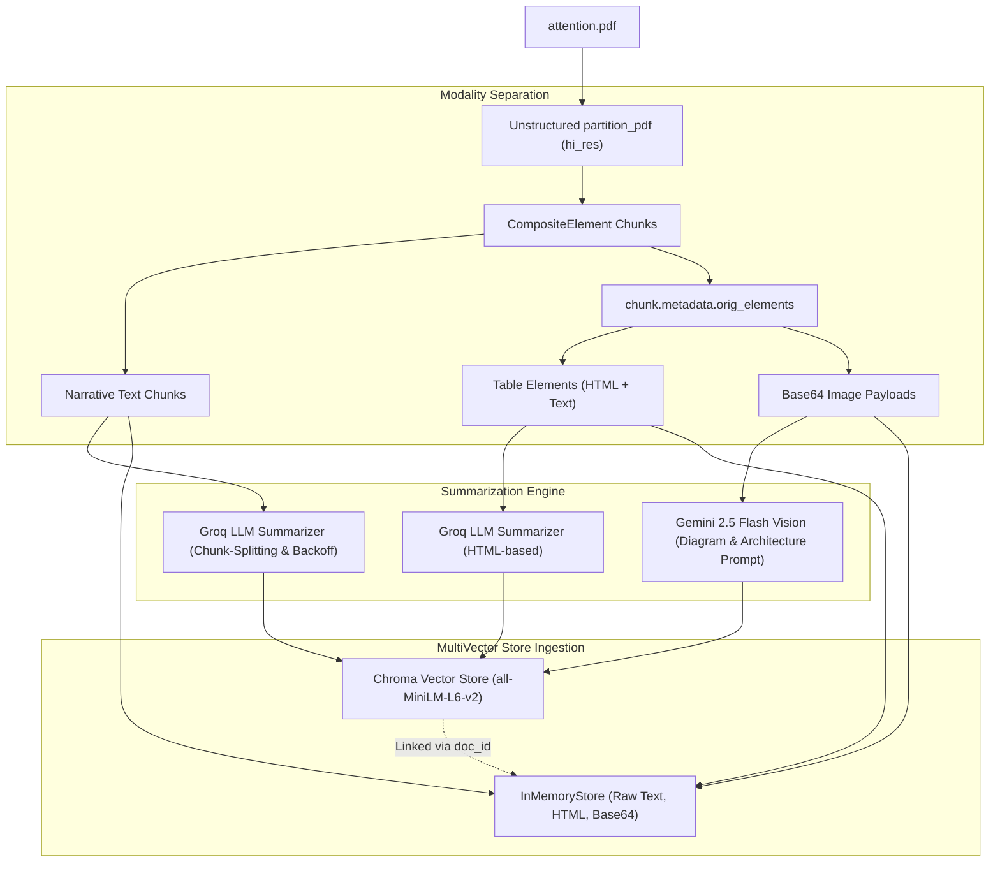

# Multimodal RAG & Knowledge Graph Implementation Guide

This document records the complete architecture, current implementations, solved bottlenecks, and evolution roadmap for the Multimodal RAG system in this project (based on [`Untitled3-2.ipynb`](./Untitled3-2.ipynb) and [`attention.pdf`](./content/attention.pdf)).

---

## 1. Project Overview & Objective

The goal of this module is to implement an advanced **Multimodal Retrieval-Augmented Generation (RAG)** pipeline capable of processing complex technical literature (specifically the foundational paper *"Attention Is All You Need"*). 

Unlike standard text-only RAG, this system simultaneously ingests:
1. **Unstructured Narrative Text** (Sections, equations, descriptions)
2. **Tabular Data** (Hyperparameters, BLEU benchmark results, complexity comparisons)
3. **Architectural Visuals & Figures** (Scaled Dot-Product Attention, Multi-Head Attention diagrams)

---

## 2. Architecture & Data Flow



---

## 3. Detailed Step-by-Step Implementation

### Step 1: System Dependencies & Environment Setup
- **System packages**: `poppler-utils` (PDF page rendering), `tesseract-ocr` (OCR engine), `libgl1` (OpenCV layout dependencies).
- **Python libraries**:
  - `unstructured[pdf]`: High-resolution document layout analysis.
  - `google-genai`: Official Google GenAI SDK for Gemini 2.5 Flash vision.
  - `langchain-groq`: High-throughput LLM summarization.
  - `langchain-chroma` & `langchain-huggingface`: Local vector embeddings using `sentence-transformers/all-MiniLM-L6-v2`.
  - `langchain-classic` / `InMemoryStore`: MultiVector document key-value store.

---

### Step 2: High-Resolution PDF Partitioning
In Cell 8, the PDF is partitioned using `unstructured`:

```python
from unstructured.partition.pdf import partition_pdf

chunks = partition_pdf(
    filename="/content/attention.pdf",
    strategy="hi_res",
    infer_table_structure=True,
    extract_image_block_types=["Image"],
    extract_image_block_to_payload=True,
    chunking_strategy="by_title",
    max_characters=10000,
    combine_text_under_n_chars=2000,
    new_after_n_chars=6000,
)
```

---

### Step 3: Modality Extraction & Separation

Because `chunking_strategy="by_title"` groups elements into `CompositeElement` containers, images and tables are extracted from `chunk.metadata.orig_elements`:

#### A. Image Extraction
Decodes base64 representations directly extracted from composite elements:
```python
def get_images_base64(chunks):
    images_b64 = []
    for chunk in chunks:
        if "CompositeElement" in str(type(chunk)):
            chunk_els = getattr(chunk.metadata, "orig_elements", [])
            for el in chunk_els:
                if "Image" in str(type(el)) and hasattr(el.metadata, "image_base64"):
                    images_b64.append(el.metadata.image_base64)
    return images_b64

images = get_images_base64(chunks)
```

#### B. Table Extraction
Extracts `Table` objects preserving their rich HTML representation (`metadata.text_as_html`):
```python
tables = []
text = []

for chunk in chunks:
    if hasattr(chunk.metadata, "orig_elements"):
        for el in chunk.metadata.orig_elements:
            if "Table" in str(type(el)):
                tables.append(el)
                
    if "CompositeElement" in str(type(chunk)):
        text.append(chunk)
```

---

### Step 4: Multi-Engine Summarization

#### A. Text & Table Summarization (Groq LLM)
Uses `ChatGroq` with `RecursiveCharacterTextSplitter` and automatic rate-limit backoff (`Retry-After` header parsing):
- **Text**: Summarizes paragraphs and section concepts.
- **Tables**: Summarizes `table.metadata.text_as_html` to preserve rows, columns, headers, and statistical relationships.

#### B. Visual / Diagram Summarization (Google Gemini 2.5 Flash)
Visual diagrams (e.g., Figure 1: The Transformer Architecture, Figure 2: Scaled Dot-Product & Multi-Head Attention) are passed directly as byte payloads to `gemini-2.5-flash`:
```python
from google import genai
from google.genai import types
import base64

client = genai.Client(api_key=os.environ["GEMINI_API_KEY"])

prompt = """
Describe this image from the research paper "Attention Is All You Need".
Explain the architecture, labels, arrows, graphs, and important results.
Be specific, and do not invent details.
"""

response = client.models.generate_content(
    model="gemini-2.5-flash",
    contents=[
        prompt,
        types.Part.from_bytes(
            data=base64.b64decode(image_b64),
            mime_type="image/jpeg"
        )
    ]
)
```

---

### Step 5: Multi-Vector Indexing (Chroma + InMemoryStore)

Instead of fragile index loops, items and summaries are paired using a synchronized indexing helper:

```python
import uuid
from langchain_core.documents import Document

def add_multimodal_to_retriever(retriever, items, summaries, modality_type):
    """
    Safely pairs items and summaries, synchronizes IDs, and adds to both
    vectorstore (summaries) and docstore (raw contents).
    """
    docs = []
    store_records = []
    
    for item, summary in zip(items, summaries):
        if not summary or not summary.strip():
            continue
            
        doc_id = str(uuid.uuid4())
        
        # Get raw content for the docstore
        if hasattr(item, "text"):
            raw_content = item.text
        elif hasattr(item, "metadata") and hasattr(item.metadata, "text_as_html"):
            raw_content = item.metadata.text_as_html or item.text
        else:
            raw_content = item  # Base64 image string
            
        # Add summary document to vectorstore
        docs.append(Document(
            page_content=summary,
            metadata={retriever.id_key: doc_id, "type": modality_type}
        ))
        store_records.append((doc_id, raw_content))
        
    if docs:
        retriever.vectorstore.add_documents(docs)
        retriever.docstore.mset(store_records)
        print(f"✅ Added {len(docs)} {modality_type} chunks to retriever.")
    else:
        print(f"⚠️ No valid {modality_type} summaries to index (skipped).")

# Index all modalities
add_multimodal_to_retriever(retriever, text, text_summaries, "text")
add_multimodal_to_retriever(retriever, images, image_summaries, "image")
add_multimodal_to_retriever(retriever, tables, table_summaries, "table")
```

---

## 4. Key Bottlenecks Diagnosed & Resolved

### 1. `len(tables) == 0` Despite Tables Existing in the PDF
- **Cause**: Unstructured's `chunking_strategy="by_title"` merges text and tables into chunks of type `CompositeElement`. The original code checked `if "Table" in str(type(x))`, which was always `False`.
- **Solution**: Unpacked tables from `chunk.metadata.orig_elements`, recovering all 4 tables with intact `metadata.text_as_html`.

### 2. `IndexError` & Chroma `ValueError: Expected Embeddings to be non-empty`
- **Cause**: 
  - Code used `enumerate(image_summaries)` and indexed `image_ids[i]`. When `images` was re-initialized to `[]` in an earlier cell or had failed summaries, `len(image_ids) != len(image_summaries)`, raising `IndexError`.
  - Chroma fails with `ValueError` if an empty document list `[]` is passed to `add_documents()`.
- **Solution**: Replaced index-based lookups with `zip(items, summaries)` and added `if docs:` guards.

### 3. API Key Security
- **Observation**: A raw Groq API key was pasted in Cell 37.
- **Remediation**: Advised immediate revocation and loading keys via `.env` / `os.environ`.

---

## 5. Next Phase: Adding Graph RAG & Grounded Verification

### The Limitation of Vector-Only Multimodal RAG
Vector embeddings match semantic similarity between queries and individual summaries. However, cross-modal dependencies are lost (e.g., how the hyperparameters in **Table 3** configure the attention heads visualized in **Figure 2**).

### Graph RAG Evolution Architecture
1. **Heterogeneous Knowledge Graph**:
   - **Nodes**: `Entity` (e.g. `MultiHeadAttention`), `TextChunk`, `TableChunk`, `ImageChunk`.
   - **Edges**:
     - `(MultiHeadAttention)-[:ILLUSTRATED_BY]->(Figure 2)`
     - `(MultiHeadAttention)-[:EVALUATED_IN]->(Table 3)`
     - `(ScaledDotProductAttention)-[:PART_OF]->(MultiHeadAttention)`
2. **Extraction Engine**:
   - Use Gemini 2.5 Flash with Pydantic structured output (`ExtractionResult` with `entities` and `KnowledgeTriple`s) to extract relations from image descriptions, table HTML, and text.
3. **Graph Store**:
   - In-memory `NetworkX` graph for fast local querying, or embedded `Kùzu` for Cypher support.
4. **Hybrid Retrieval & Grounded Generation**:
   - Retrieve seed nodes via Chroma vector search.
   - Traverse 1-to-2 hops in the graph to gather structurally linked figures, tables, and facts.
   - Feed raw images + HTML tables + graph facts into Gemini with strict sentence-level citation constraints (`[Source: Text <id>]`, `[Source: Figure <id>]`, `[Source: Table <id>]`).

---

## 6. Critical Engineering Enhancements & Validation

Before scaling to Graph RAG and Agentic tools, three core production issues must be addressed:

### 6.1 Mitigating Summary Distortion via Dual / Hybrid Indexing
- **The Vulnerability**: Embedding *only* LLM summaries can cause severe retrieval degradation on queries targeting exact numbers (e.g. `28.4 BLEU`, `3.3 · 10^18 FLOPs`, `d_model=512`), equations ($\text{Attention}(Q,K,V)=\text{softmax}(\frac{QK^T}{\sqrt{d_k}})V$), or table rows. Summaries routinely condense or drop these details.
- **The Architectural Fix**:
  - **Hybrid Dual-Indexing**: For text and tables, embed a concatenated representation:
    ```python
    embedded_content = f"{summary.strip()}\n\n[Exact Source Content Details]:\n{raw_content}"
    ```
  - This preserves broad semantic matchability via the summary while retaining high-precision keyword/numeric matchability from the raw source.
  - The `docstore` continues to serve the original raw HTML / text upon retrieval.

### 6.2 Safe Multimodal Image Pipeline (Dynamic MIME & Byte Validation)
- **The Vulnerability**: Hardcoding `mime_type="image/jpeg"` causes crashes, API rejections, or degraded vision capabilities when images extracted from PDFs are PNG, WebP, or malformed.
- **The Architectural Fix** ([`image_pipeline.py`](./image_pipeline.py)):
  1. **Magic Bytes Inspection**: Inspects the first 16 bytes (`\x89PNG\r\n\x1a\n` $\rightarrow$ `image/png`, `\xff\xd8\xff` $\rightarrow$ `image/jpeg`, etc.).
  2. **Pillow Byte Verification**: Calls `Image.open().verify()` to detect truncated or corrupted base64 payloads before sending to Gemini.
  3. **Validated Image Object**: Returns `ValidatedImage` containing exact dimensions, verified MIME type, and safe data URIs for rendering.

### 6.3 Empirical Evaluation Harness & Golden Dataset Benchmark
- **The Vulnerability**: Deploying RAG pipelines without quantitative retrieval and groundedness metrics makes it impossible to detect regression or quantify summary distortion.
- **The Architectural Fix** ([`eval_dataset.json`](./eval_dataset.json) & [`evaluate_rag.py`](./evaluate_rag.py)):
  - **10-Case Golden Evaluation Dataset**: Curated specifically for `attention.pdf` across 3 distinct test categories:
    - **Numerical** (5 test cases): Exact BLEU scores, training FLOPs, model parameters ($N, d_{\text{model}}, d_{ff}, h$).
    - **Terminology & Equations** (3 test cases): Exact formulas for Scaled Dot-Product Attention, FFN, and Table 1 complexity $O(n^2 \cdot d)$.
    - **Visual Architecture** (2 test cases): Figure 1 Positional Encoding placement and Figure 2 Scaled Dot-Product layer flow.
  - **Recall@K Evaluation**: Measures exact entity and fact retention in retrieved context, proving the superiority of Hybrid Indexing over Summary-Only indexing.


